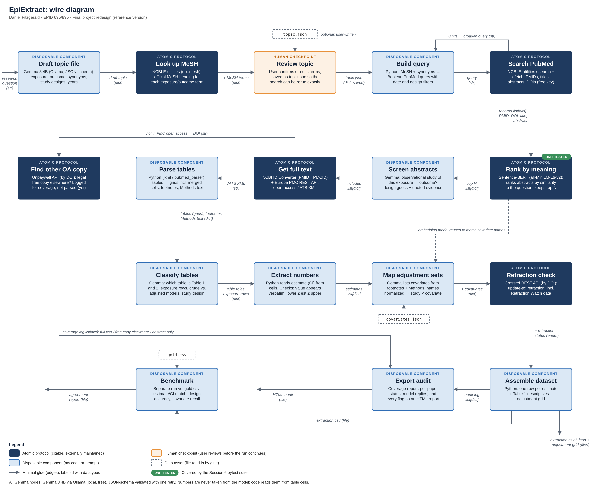

# EpiExtract

EpiExtract is a tool in development that searches PubMed for observational studies on an epidemiologic question, reads the open-access full text, and extracts each study's design, descriptive statistics (Table 1), effect estimates (OR, RR, or HR with 95% CIs, Table 2), and adjustment sets into one structured dataset. It also checks each paper for retractions. Stages 1–8 (from the research question to downloaded full text) are built; table extraction, adjustment-set mapping, the retraction check, and the benchmark come next. The repository also holds the unit tests for one of its atomic protocols: **Rank by meaning**, which uses [Sentence-BERT](https://www.sbert.net) to rank PubMed abstracts by how closely they match the research question.

## Wire diagram

Rank by meaning sits between the PubMed search and Gemma's abstract screening: it ranks the retrieved abstracts by similarity to the research question so only the most relevant ones go on to screening.



## Running EpiExtract (stages 1–8)

EpiExtract runs locally and for free. Gemma 3 4B runs on your own computer through [Ollama](https://ollama.com), and every other step uses free public APIs (NCBI E-utilities, Europe PMC, Unpaywall).

1. Install Ollama, open it, and download the model once: `ollama pull gemma3:4b`
2. Set up the environment (see **Setup** below).
3. Set a contact email. NCBI asks programs to include one with each request, and Unpaywall (which looks for free copies of papers that aren't in PubMed Central) requires one. It is read from your environment, never stored in the code:
   `export EPIEXTRACT_EMAIL=you@example.com`
   EpiExtract also sends the tool name `epiextract` with NCBI requests and keeps NCBI calls under 3 per second. With a free NCBI API key (create one under Account settings at ncbi.nlm.nih.gov), set as `export NCBI_API_KEY=...`, the limit rises to 10 per second.
4. Run it with a research question:

```bash
python -m epiextract "Is childhood trauma associated with psychosis in adulthood?"
```

The tool drafts a topic file (exposure, outcome, synonyms, and MeSH headings) and pauses so you can review it. Open the `topic.json` it names, edit the terms if needed, save, and press Enter. To rerun the exact same search later, pass the reviewed file back in:

```bash
python -m epiextract --topic runs/<run folder>/topic.json
```

Useful options: `--yes` (skip the review pause), `--max-records 200` (papers fetched from PubMed), `--top-n 40` (papers kept for screening), `--oa-only` (search only PubMed Central's open-access subset).

Each run writes a folder under `runs/` containing:

| File | What it holds |
|---|---|
| `topic.json` | The reviewed search strategy |
| `query.txt` | The exact PubMed query |
| `records.csv` | Every paper fetched from PubMed, with its similarity score |
| `screening.csv` | Gemma's decision, study design, reason, and quoted evidence for each ranked paper |
| `coverage.csv` | The full-text status of each included paper |
| `xml/` | Open-access JATS XML for included papers (input for table extraction) |
| `audit.html` | Every step, model reply, and flag, for a person to check |

### Code checks on the model

- MeSH headings come from PubMed's own term mapping, not from Gemma.
- Each screening decision must quote the abstract. Quotes that can't be found in the abstract are flagged in the audit.
- Trials and reviews are excluded by rule, even if Gemma marks them relevant.
- Full text is downloaded only for papers in the open-access subset, which is licensed for text mining.

## Contract

| | Type | Description |
|---|---|---|
| **Input (encode)** | `str` or `list[str]` | English text: a research question, exposure/outcome terms, abstracts |
| **Output (encode)** | `numpy.ndarray` (float32) | Shape `(384,)` or `(n, 384)`; each vector has length 1 |
| **Input (compare)** | two embedding arrays | Queries and documents from encode |
| **Output (compare)** | `torch.Tensor` (float32) | Cosine similarity, shape `(n_queries, n_documents)`, values from −1 to 1 |

```python
model = SentenceTransformer("sentence-transformers/all-MiniLM-L6-v2", device="cpu")
emb = model.encode(texts, normalize_embeddings=True, convert_to_numpy=True)
scores = model.similarity(query_emb, doc_emb)
```

Citable source: Reimers N, Gurevych I. Sentence-BERT: sentence embeddings using Siamese BERT-networks. *Proceedings of EMNLP-IJCNLP 2019*:3982-3992. https://arxiv.org/abs/1908.10084

## Tested versions

- sentence-transformers 6.2.0
- torch 2.14.1
- transformers 5.20.2
- Model `sentence-transformers/all-MiniLM-L6-v2`, pinned to the commit in `model_revision.txt`
- Python 3.10 or later

## Setup

```bash
python3 -m venv .venv
source .venv/bin/activate        # Windows: .venv\Scripts\activate
pip install -r requirements.txt
```

The model (about 90 MB) downloads from Hugging Face on the first run.

## Running the tests

```bash
python -m pytest -v
```

Expected result: **65 passed, 3 xfailed** (one FutureWarning about a renamed method is expected). That's 52 Sentence-BERT tests in `test_rank_by_meaning.py`, plus 13 offline tests in `tests/` covering EpiExtract's own code: the query builder, cleaning search terms, validating topic files, verifying evidence quotes, and parsing PubMed records.

## What the tests cover

- **Typical inputs:** output shape, data type, and unit length; identical results on repeated runs; cosine similarity in the right range; documented example scores from the Sentence-BERT docs; public health synonyms ranked correctly (for example, "vaping" → "electronic vapor product use", "high blood pressure" → "hypertension", "SES", "PTSD"), including survey-question wording.
- **Edge cases:** empty strings and lists, whitespace, long inputs truncated at 256 word pieces, statistical notation and symbols (β, ≥, ±, 95% CI), non-English text, ties.
- **Invalid inputs:** `None`, integers, lists containing `None`, and mismatched embedding sizes raise errors instead of returning a result.

## Known limitations

These are marked `xfail(strict=True)`, so the suite will fail loudly if a future release changes the behavior:

- **Shared words beat meaning for short queries.** "Heart attack" ranks "Heart failure" and "Panic attack" above "Acute myocardial infarction" (tested in two forms). EpiExtract therefore also searches with generated synonym terms rather than relying on Sentence-BERT alone.
- **Abbreviations lose their case.** The model lowercases input, so "ENDS" (electronic nicotine delivery systems) is read as the word "ends".
